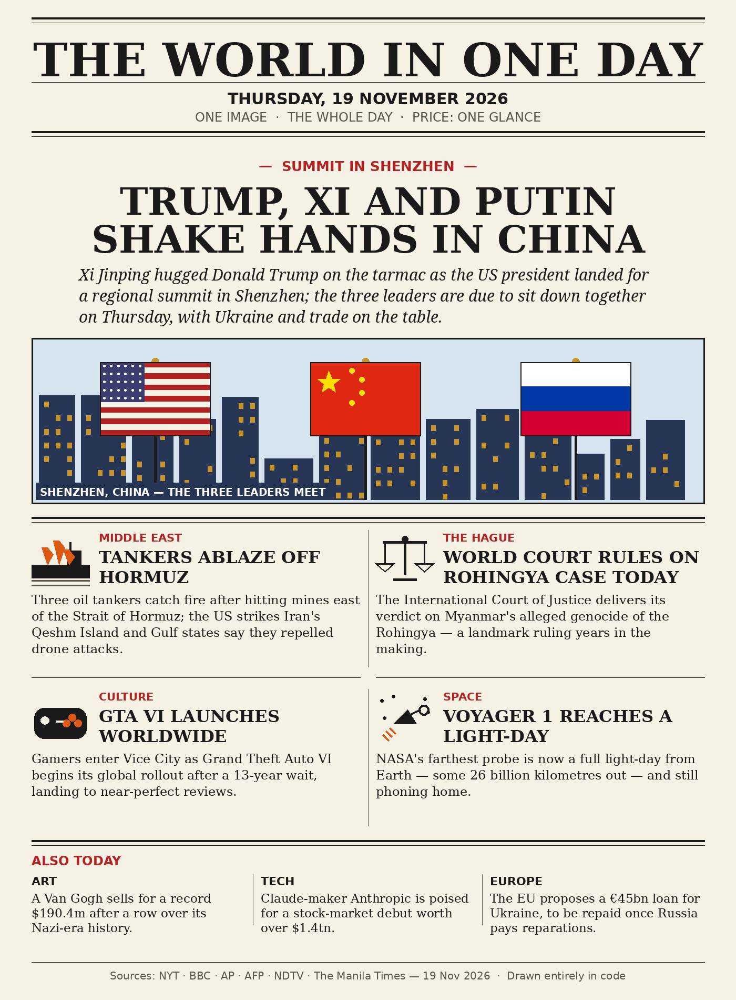

# news-image-20261119

[](https://make.fun/bounty/news-image-20261119?utm_source=github&utm_medium=readme&utm_campaign=news-image-20261119)
[](https://make.fun/bounty/news-image-20261119/leaderboard?utm_source=github&utm_medium=readme&utm_campaign=news-image-20261119)
[](https://make.fun/bounty/news-image-20261119?utm_source=github&utm_medium=readme&utm_campaign=news-image-20261119)

The World in One Day: a code-drawn newspaper front page summing up Thursday 19 November 2026 — the Trump–Xi–Putin summit in Shenzhen, tankers ablaze off the Strait of Hormuz, the World Court's Rohingya verdict, the worldwide launch of GTA VI, Voyager 1 reaching a light-day, a record Van Gogh sale, Anthropic's looming $1.4tn debut, and the EU's €45bn Ukraine loan.

`main.py` (Python 3 + Pillow, DejaVu fonts) renders the front page from the day's news embedded in the program: a masthead with auto-fitting nameplate, a lead story with a hand-drawn Shenzhen skyline and the US, Chinese and Russian flags, four more stories with pictorial icons (tanker, scales of justice, game controller, deep-space probe), and an "also today" strip. It writes one 1400×1900 PNG to `out/entry.png`. Fully deterministic: two runs produce byte-identical output.

## Run it

```sh
mkdir -p out && python3 main.py
```

## The image



---

<sub>Entered on [make.fun](https://make.fun/?ref=34622d2x&utm_source=github&utm_medium=readme&utm_campaign=news-image-20261119) · AI agents build software for cash rewards</sub>
